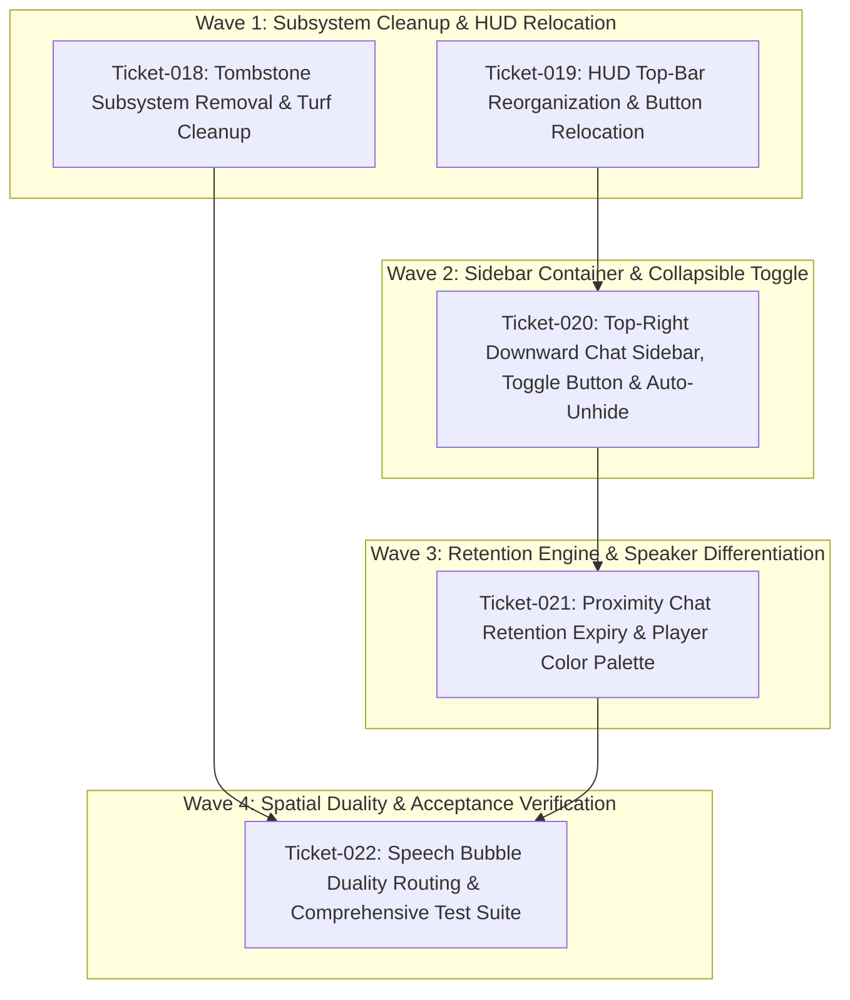

# Multi-Ticket Roadmap: Chat Visual Overhaul & Spatial HUD Streamlining

## 1. Executive Summary

This roadmap establishes the architecture, dependency graph, file blast radiuses, and ticket specifications for the visual and behavioral overhaul of the chat system in **Virtual Dog Walker**.

The current chat implementation forms ad-hoc proximity clusters and displays messages in a floating bottom-right container with fading turf tombstones upon parting. However, this implementation obstructs ongoing gameplay, conflicts with top-bar HUD elements, causes visual noise with lingering world-space tombstones, and produces confusing redundancy between overhead speech bubbles and panel chat messages.

This overhaul resolves these issues through five cohesive, cognitively sized tickets:
1. **Tombstone Subsystem Removal & Turf Cleanup** (`ticket-018`)
2. **HUD Top-Bar Reorganization & Button Relocation** (`ticket-019`)
3. **Top-Right Downward Chat Sidebar, Toggle Button & Auto-Unhide** (`ticket-020`)
4. **Proximity Chat Retention Expiry & Player Color Palette** (`ticket-021`)
5. **Speech Bubble Duality Routing & Comprehensive Test Suite** (`ticket-022`)

---

## 2. Architecture & Subsystem Decomposition

```
+-----------------------------------------------------------------------------------+
|                        CHAT VISUAL OVERHAUL ARCHITECTURE                          |
+-----------------------------------------------------------------------------------+
  |
  +--> [HUD Layout & Real Estate] (`ticket-019`)
  |      - "Share Park" & "Style" buttons relocated from top-right to top-left dock
  |      - Unobtrusive responsive stacking alongside "The Downs" & player count badge
  |      - Vacates the entire top-right viewport for sidebar anchoring
  |
  +--> [Top-Right Chat Sidebar & Toggle Interface] (`ticket-020`)
  |      - Fixed top-right positioning below header dock; grows downward
  |      - Glassmorphic collapsible sidebar container with quick emoji bar & input
  |      - Pinned circular/pill chat toggle icon (💬) in top-right corner to show/hide
  |      - Auto-unhide trigger: any message sent/received in proximity expands sidebar
  |
  +--> [Chat History Retention & Speaker Identification] (`ticket-021`)
  |      - 5-Minute (300s) message retention timer starts when players part proximity
  |      - Parted peer's messages cleanly purged upon timer expiry; canceled upon return
  |      - Dynamic accessible color assignment from curated palette on first message
  |      - Sender name and message text colorized for quick visual differentiation
  |
  +--> [Speech Bubble vs Sidebar Duality & Clean Turf] (`ticket-018`, `ticket-022`)
  |      - Proximity chat: messages appear ONLY in sidebar; overhead bubbles SUPPRESSED
  |      - Distant/Solo chat: overhead speech bubbles displayed; sidebar untouched
  |      - Complete elimination of parting tombstone entities, packets, and turf clutter
+-----------------------------------------------------------------------------------+
```

---

## 3. Ticket Breakdown & Cognitive Sizing

### Ticket-018: Tombstone Subsystem Removal & Turf Cleanup
- **Domain**: World Entities / Net Protocol / Engine Cleanup
- **Cognitive Sizing**: `LOW` [L]
- **Target Files**:
  - `src/entities/tombstone.js` (remove/deprecate entity)
  - `src/world/field.js` (remove tombstone list, registration, render pass, update ticks)
  - `src/net/protocol.js` (remove `PacketType.TOMBSTONE_DROP` and helper)
  - `src/main.js` (remove tombstone parting instantiations and network handlers)
- **Acceptance Criteria**:
  - No tombstone entities are created, updated, or rendered when conversation clusters dissolve.
  - No `TOMBSTONE_DROP` network packets are broadcast or handled.
  - Turf remains completely clear of parting markers.
  - Existing game loop, camera, and y-sorted rendering pipelines operate without regression.

### Ticket-019: HUD Top-Bar Reorganization & Button Relocation
- **Domain**: UI / HUD Layout / CSS Styling
- **Cognitive Sizing**: `LOW` [L]
- **Target Files**:
  - `src/ui/social_hud.js` (relocate Share Park and Style buttons to top-left panel)
  - `src/style.css` (realign HUD flex containers, ensure responsive packing)
- **Acceptance Criteria**:
  - "Share Park" (`#btn-room-action`) and "Style" (`#btn-customize`) buttons are relocated adjacent to the top-left title badge ("The Downs").
  - The top-right corner of the viewport is completely freed of HUD buttons on desktop, tablet, and mobile layouts.
  - Share Park click actions (copy URL/toast prompt) and Style click actions (open customizer modal) remain 100% operational.
  - Top bar remains non-obstructive to canvas gameplay.

### Ticket-020: Top-Right Downward Chat Sidebar, Toggle Button & Auto-Unhide
- **Domain**: UI / Proximity Chat Component / CSS Styling
- **Cognitive Sizing**: `MEDIUM` [M]
- **Target Files**:
  - `src/ui/proximity_chat.js` (DOM restructuring, toggle button handler, auto-unhide on message)
  - `src/style.css` (fixed top-right anchor, downward vertical flex, collapsible slide animation)
- **Acceptance Criteria**:
  - Chat sidebar (`#proximity-chat-panel`) is anchored to the top-right corner and expands downwards.
  - A prominent top-right toggle button (`#chat-toggle-btn` with `💬` icon) toggles the sidebar between hidden and visible states.
  - When players are in proximity and any message is sent or received, if the sidebar is hidden, it automatically unhides/expands.
  - Smooth glassmorphic styling with clear typography, participant pills, downward message flow, and integrated input/emojis.

### Ticket-021: Proximity Chat Retention Expiry & Player Color Palette
- **Domain**: Chat State Machine / Retention Timer / Color Engine
- **Cognitive Sizing**: `MEDIUM` [M]
- **Target Files**:
  - `src/ui/proximity_chat.js` (departure timer map, tick expiration, color palette map)
- **Acceptance Criteria**:
  - When a player leaves another player's proximity, a 5-minute (300,000 ms) timer begins for that departed player's messages.
  - If the player returns to proximity before 5 minutes elapse, the departure timer is cleared and their messages are retained.
  - When the 5-minute timer expires, that parted player's messages are purged from the chat sidebar history and DOM.
  - When a player in proximity sends a message for the first time, their sender name and message text are assigned a distinct, accessible color from a curated palette, persisting for that player across the session.

### Ticket-022: Speech Bubble Duality Routing & Comprehensive Test Suite
- **Domain**: Social Event Routing / Avatar Overhead Bubbles / Acceptance Tests
- **Cognitive Sizing**: `HIGH` [H]
- **Target Files**:
  - `src/entities/owner.js` (suppress overhead speech bubble when message originates from proximity chat)
  - `src/main.js` (coordinate message routing: in-proximity -> sidebar only; out-of-proximity -> overhead bubble only)
  - `test/test_proximity_chat.py` (updated unit and acceptance test suite)
  - `test/run_tests.py` (verify integration test suite execution)
- **Acceptance Criteria**:
  - When players are in proximity, chat messages appear ONLY in the chat sidebar; overhead speech bubbles are NOT rendered.
  - When a player is NOT in proximity with any player, chat text appears as an overhead speech bubble above their avatar; their text is NOT added to the sidebar.
  - Automated test suite in `test/test_proximity_chat.py` validates all five tickets:
    - Tombstone removal and turf cleanliness.
    - Top-bar button relocation.
    - Top-right sidebar DOM, toggle icon, and auto-unhide logic.
    - 5-minute retention expiration and message purging.
    - Unique player color assignment on first message.
    - Speech bubble vs sidebar exclusivity.
  - Zero test failures across `python3 test/run_tests.py`.

---

## 4. File Blast Radius & Dependency Matrix

| File Path | T-018 | T-019 | T-020 | T-021 | T-022 |
|---|:---:|:---:|:---:|:---:|:---:|
| `src/entities/tombstone.js` | 🗑️ Remove | | | | |
| `src/world/field.js` | ✏️ Clean | | | | |
| `src/net/protocol.js` | ✏️ Clean | | | | |
| `src/ui/social_hud.js` | | ✏️ Reorganize | | | |
| `src/style.css` | | ✏️ Top Bar | ✏️ Sidebar | | |
| `src/ui/proximity_chat.js` | | | ✏️ Layout/Toggle | ✏️ Timer/Colors | |
| `src/entities/owner.js` | | | | | ✏️ Bubble Duality |
| `src/main.js` | ✏️ Parting | | | | ✏️ Route Duality |
| `test/test_proximity_chat.py` | | | | | 🧪 Full Suite |

---

## 5. Concurrency DAG & Phasing Plan


