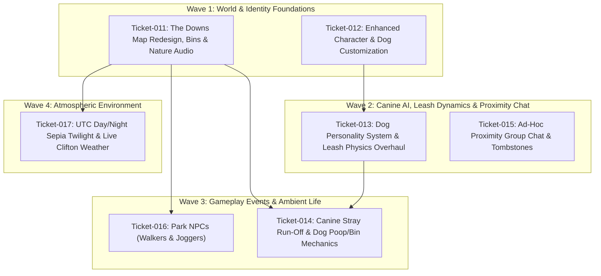

# Multi-Ticket Roadmap: "The Downs" Social Sandbox Expansion

## 1. Executive Summary

This roadmap establishes the architecture, dependency graph, file blast radiuses, and ticket specifications for the major expansion of **Virtual Dog Walker**, transforming the park into **"The Downs"** inspired by the real **Clifton and Durdham Downs** in Bristol, UK.

The expansion encompasses seven cohesive, cognitively bounded feature domains:
1. **The Downs Map Redesign, Bins & Nature Audio** (`ticket-011`)
2. **Enhanced Character & Canine Customization & 2D Aesthetics** (`ticket-012`)
3. **Canine Personality System & Leash Physics Overhaul** (`ticket-013`)
4. **Canine Stray Run-Off, Directional Arrows & Dog Poop/Bin Mechanics** (`ticket-014`)
5. **Ad-Hoc Proximity Group Chat & Tombstone Lifecycle** (`ticket-015`)
6. **Park NPCs: Autonomous Walkers & Joggers** (`ticket-016`)
7. **UTC Day/Night Sepia Twilight & Clifton Downs Live Weather** (`ticket-017`)

---

## 2. Architecture & Subsystem Decomposition

```
+-----------------------------------------------------------------------------------+
|                                  THE DOWNS CORE                                   |
+-----------------------------------------------------------------------------------+
  |
  +--> [World & Environment]
  |      - "The Downs" Meadow Map: Ladies Mile, Sea Walls, Water Tower, Observatory
  |      - Public Dog-Waste Bins & Teak Benches
  |      - Day/Night Sepia Twilight Lighting Shader (UTC)
  |      - Live Clifton Downs Weather Integration (Open-Meteo API + Canvas Particles)
  |      - Rich Procedural Web Audio Nature Soundscape (Breeze, Birdsong, Foliage)
  |
  +--> [Entities & Canine AI]
  |      - Enhanced 2D Vector/Sprite Aesthetics (Owner Avatars & Dogs)
  |      - Dog Personality Engine: (Playfulness, Shyness, Barkyness, Obedience) [1-5]
  |      - Overhauled Leash Dynamics: No Ball Chasing on Lead, Lead Pulling Physics
  |      - Idle Stray Run-Off Event (Obedience-weighted) + Navigation Compass Arrow
  |      - Dog Poop Event + Pickup + Navigation Arrow to Nearest Dog Bin
  |      - Ambient NPCs: Leisure Walkers & Athletic Joggers with Trail Navigation
  |
  +--> [Social & Multiplayer UI]
  |      - Ad-Hoc Spatial Proximity Chat Clusters (Dynamic Join/Leave for 2+ Players)
  |      - Walking-Alongside Conversation Persistence
  |      - Parting "Tombstone" Chat Markers on the Turf (Gradual Dissolve)
  |      - Tabbed Human & Canine Customizer with Profile Persistence & Net Sync
+-----------------------------------------------------------------------------------+
```

---

## 3. Ticket Breakdown & Cognitive Sizing

### Ticket-011: The Downs Map Redesign Inspired by Clifton & Durdham Downs, Waste Bins & Nature Soundscape
- **Domain**: World / Rendering / Audio
- **Cognitive Sizing**: `HIGH` [H]
- **Target Files**:
  - `src/world/field.js` (expand coordinate space, Ladies Mile avenue, Sea Walls overlook, Observatory clearing, Water Tower, dog waste bins)
  - `src/systems/audio.js` (expanded multi-track procedural nature soundscape: rustling leaves, blackbird, robin, woodpigeon calls)
  - `index.html` (rename title and header branding to "The Downs")
- **Acceptance Criteria**:
  - Map geometry reflects Clifton & Durdham Downs layout with named paths and landmark clearings.
  - At least 8 dog-waste bins strategically placed alongside teaks benches and path intersections.
  - Web Audio nature soundscape plays soothing ambient wind and authentic British birdsong with smooth volume modulation.
  - Zero regression in camera clamping, y-sorting depth, or collision resolution.

### Ticket-012: Enhanced Character & Canine Customization & 2D Aesthetics
- **Domain**: Entities / Avatars / UI / Styling
- **Cognitive Sizing**: `MEDIUM` [M]
- **Target Files**:
  - `src/entities/owner.js` (enhanced 2D avatar rendering: hairstyle, outfit styles, skin tones, shoes, fluid walk cycles)
  - `src/entities/companion_dog.js` (enhanced 2D dog rendering: ear textures, snout details, collar charm, paw strides)
  - `src/ui/social_hud.js` (tabbed customizer for Walker and Dog)
  - `src/style.css` (customizer styling polish)
- **Acceptance Criteria**:
  - Owner avatar has selectable hair styles/colors, jacket styles, pants, and skin tones.
  - Dog companion has expanded coat presets and collar color customization.
  - Visuals remain crisp, charming 2D top-down style.
  - Customization saves to `localStorage` and synchronizes across multiplayer peers via `HELLO` and `SYNC_STATE`.

### Ticket-013: Canine Personality System & Leash Physics Overhaul
- **Domain**: Dog AI / Leash Physics / Protocol
- **Cognitive Sizing**: `HIGH` [H]
- **Target Files**:
  - `src/entities/companion_dog.js` (personality trait integration, leash pulling force, leash ball-chase prohibition)
  - `src/ui/social_hud.js` (personality attribute sliders 1–5 in customizer)
  - `src/net/protocol.js` (include personality attributes in peer metadata and sync packets)
- **Acceptance Criteria**:
  - Dog personality attributes: Playfulness, Shyness, Barkyness, Obedience (scale 1 to 5).
  - When leashed, dog NEVER breaks into `FETCHING` state or chases balls; looks towards ball with eager pull.
  - Leashed dog strictly respects maximum leash length, but exerts pulling force on lead when wanting to move.
  - Leash line renders taut when pulling occurs.
  - Personality settings persist and affect steering and vocalization behaviors.

### Ticket-014: Canine Stray Run-Off, Directional Arrows & Dog Poop/Bin Mechanics
- **Domain**: Gameplay Loops / Events / Navigation HUD
- **Cognitive Sizing**: `MEDIUM` [M]
- **Target Files**:
  - `src/entities/companion_dog.js` (idle detection, stray trigger, poop timer & drop animation)
  - `src/world/field.js` (poop entity management, bin registry query)
  - `src/ui/navigation_arrow.js` (new directional HUD compass arrow for lost dog and nearest bin)
  - `src/main.js` (poop pickup interaction <kbd>E</kbd>/tap, bin disposal)
- **Acceptance Criteria**:
  - Standing idle for >40 seconds without whistling triggers stray run-off roll, weighted inversely by Obedience.
  - Lost dog runs off/teleports to secluded meadow spot and waits; directional HUD arrow points directly to dog.
  - Reaching dog or whistling recalls dog and clears the lost arrow.
  - Periodic dog poop event spawns a clean-up prompt; picking up poop activates a directional HUD arrow to the nearest bin.
  - Disposing poop in bin grants positive feedback chime.

### Ticket-015: Ad-Hoc Proximity Group Chat & Tombstone Lifecycle
- **Domain**: Social / Spatial Networking / UI
- **Cognitive Sizing**: `HIGH` [H]
- **Target Files**:
  - `src/ui/proximity_chat.js` (new ad-hoc spatial group chat manager)
  - `src/entities/tombstone.js` (new world-space fading conversation tombstone entity)
  - `src/ui/social_hud.js` (prominent active conversation display)
  - `src/net/protocol.js` & `party/server.js` (spatial chat relay)
  - `src/style.css`
- **Acceptance Criteria**:
  - Proximity clusters form dynamically when 2+ players are within ~200px.
  - Prominent on-screen conversation interface displays active participants and chat thread.
  - Players seamlessly join/leave the chat as they walk into or out of proximity.
  - Walking alongside keeps players continuously in the conversation.
  - When players part and exit proximity with all peers, the conversation drops as a fading "tombstone" marker on the turf that dissolves over 10 seconds.

### Ticket-016: Park NPCs: Autonomous Walkers & Joggers
- **Domain**: Ambient Entities / Path Navigation
- **Cognitive Sizing**: `MEDIUM` [M]
- **Target Files**:
  - `src/entities/npc.js` (new `WalkerNPC` and `JoggerNPC` classes)
  - `src/world/field.js` (NPC update and render in y-sorted pipeline)
  - `src/main.js` (NPC population management)
- **Acceptance Criteria**:
  - Pedestrian walkers stroll along footpaths, pause at benches or scenic overlooks.
  - Joggers run at athletic pace (~260 px/s) along perimeter and Ladies Mile path loops.
  - NPCs avoid collisions with players and dogs; dogs react according to their personality traits.
  - Y-sorted rendering with natural depth sorting.

### Ticket-017: UTC Day/Night Sepia Twilight & Clifton Downs Live Weather
- **Domain**: Atmospheric Shaders / Live Weather API / Audio
- **Cognitive Sizing**: `MEDIUM` [M]
- **Target Files**:
  - `src/world/environment.js` (new day/night lighting pass & weather controller)
  - `src/systems/weather.js` (Open-Meteo live API client + offline fallback simulation)
  - `src/world/field.js` (sepia twilight lighting filter, streetlamp glows, rain particles)
  - `src/systems/audio.js` (weather audio modulation: rain on leaves, wind gusts)
- **Acceptance Criteria**:
  - Day/night cycle synchronized with UTC / Bristol sunrise and sunset.
  - Night renders with an evocative sepia twilight color grading and warm glowing park lamps.
  - Clifton Downs weather fetched live via Open-Meteo API with offline simulated fallback.
  - Weather states (clear, overcast, drizzle, rain, fog) trigger matching particle overlays and sound effects.

---

## 4. File Blast Radius & Dependency Matrix

| File Path | T-011 | T-012 | T-013 | T-014 | T-015 | T-016 | T-017 |
|---|:---:|:---:|:---:|:---:|:---:|:---:|:---:|
| `src/world/field.js` | ✏️ Core | | | 🔍 Bins | | 🔍 Paths | 🎨 Light |
| `src/systems/audio.js` | ✏️ Core | | | | | | 🔊 Rain |
| `src/entities/owner.js` | | ✏️ Core | | | | | |
| `src/entities/companion_dog.js` | | ✏️ Draw | ✏️ Leash/AI | ✏️ Stray/Poop | | 🔍 React | |
| `src/ui/social_hud.js` | | ✏️ Style | ✏️ Personality | | ✏️ Chat Link | | 🔍 Weather |
| `src/ui/proximity_chat.js` (new) | | | | | ✏️ Core | | |
| `src/ui/navigation_arrow.js` (new) | | | | ✏️ Core | | | |
| `src/entities/npc.js` (new) | | | | | | ✏️ Core | |
| `src/world/environment.js` (new) | | | | | | | ✏️ Core |
| `src/systems/weather.js` (new) | | | | | | | ✏️ Core |
| `src/net/protocol.js` | | 🔍 Meta | ✏️ Schema | | ✏️ Chat | | |
| `src/main.js` | | | | ✏️ Wire | ✏️ Wire | ✏️ Wire | ✏️ Wire |

---

## 5. Concurrency DAG & Phasing Plan


