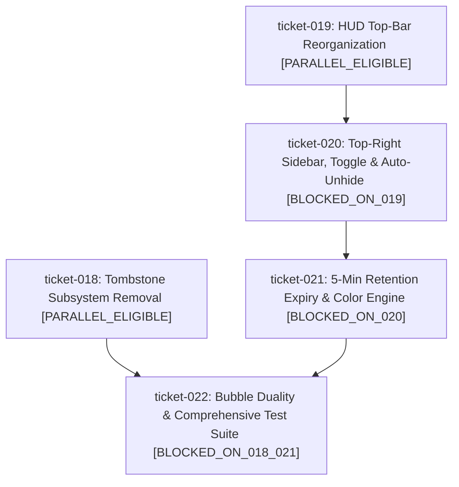

# Milestone Roadmap: Chat Visual Overhaul & Spatial HUD Streamlining

## 1. Milestone Objective & Scope
Overhaul the *Virtual Dog Walker* chat and social HUD system to prevent chat from obstructing core gameplay. Relocate conflicting top-bar HUD elements ("Share Park" and "Style" buttons) away from the top-right corner to open up dedicated screen real estate. Lock the chat sidebar to the top-right corner of the screen, expanding downward, with a collapsible toggle button. Implement automatic sidebar unhiding when proximity messages arrive, a 5-minute message retention countdown upon parting proximity, dynamic accessible color assignment for first-time messaging players, clean duality between overhead speech bubbles (out of proximity only) and sidebar text (in proximity only), and complete removal of the legacy tombstone dropping behavior.

## 2. Ticket Dependency Matrix

| Ticket ID | Title | Thinking Level | Depends On | Concurrency Track | State |
| :--- | :--- | :---: | :--- | :--- | :--- |
| `ticket-018` | Tombstone Subsystem Removal & Turf Cleanup | `LOW` | `[]` | `PARALLEL_ELIGIBLE` | `PLANNING` |
| `ticket-019` | HUD Top-Bar Reorganization & Button Relocation | `LOW` | `[]` | `PARALLEL_ELIGIBLE` | `PLANNING` |
| `ticket-020` | Top-Right Downward Chat Sidebar, Toggle Button & Auto-Unhide | `MEDIUM` | `["ticket-019"]` | `BLOCKED_ON_019` | `PLANNING` |
| `ticket-021` | Proximity Chat Retention Expiry & Player Color Palette | `MEDIUM` | `["ticket-020"]` | `BLOCKED_ON_020` | `PLANNING` |
| `ticket-022` | Speech Bubble Duality Routing & Comprehensive Test Suite | `HIGH` | `["ticket-018", "ticket-021"]` | `BLOCKED_ON_018_021` | `PLANNING` |

## 3. Blast Radius & Scope Collision Matrix

| Ticket ID | Declared File Scope | Overlap Detection & Blast Radius Rationale |
| :--- | :--- | :--- |
| `ticket-018` | `src/entities/tombstone.js`, `src/world/field.js`, `src/net/protocol.js`, `src/main.js` | Removes tombstone rendering, lifecycle ticks, and network packet. Completely disjoint from HUD styling. |
| `ticket-019` | `src/ui/social_hud.js`, `src/style.css` | Relocates Share Park & Style buttons to top-left dock. Disjoint from tombstone files. |
| `ticket-020` | `src/ui/proximity_chat.js`, `src/style.css` | Establishes top-right sidebar container, toggle icon button, auto-unhide DOM logic, and downward flow styles. Sequenced after 019 to prevent CSS collisions. |
| `ticket-021` | `src/ui/proximity_chat.js` | Adds 5-minute countdown per departed peer and accessible color assignment for new proximity speakers. Extends 020 sidebar logic. |
| `ticket-022` | `src/entities/owner.js`, `src/main.js`, `test/test_proximity_chat.py`, `test/run_tests.py` | Enforces overhead speech bubble vs sidebar exclusivity, routes proximity vs non-proximity chat events, and executes full regression test suite. |

## 4. Execution DAG Diagram

## 5. Progress & Milestone Completion Criteria
- [ ] Ticket-018 completed and merged to `main`.
- [ ] Ticket-019 completed and merged to `main`.
- [ ] Ticket-020 completed and merged to `main`.
- [ ] Ticket-021 completed and merged to `main`.
- [ ] Ticket-022 completed and merged to `main`.
- [ ] End-to-end integration tests pass across combined deliverables (`python3 test/run_tests.py`).
- [ ] Canonical specifications reconciled in `openspec/specs/`.
