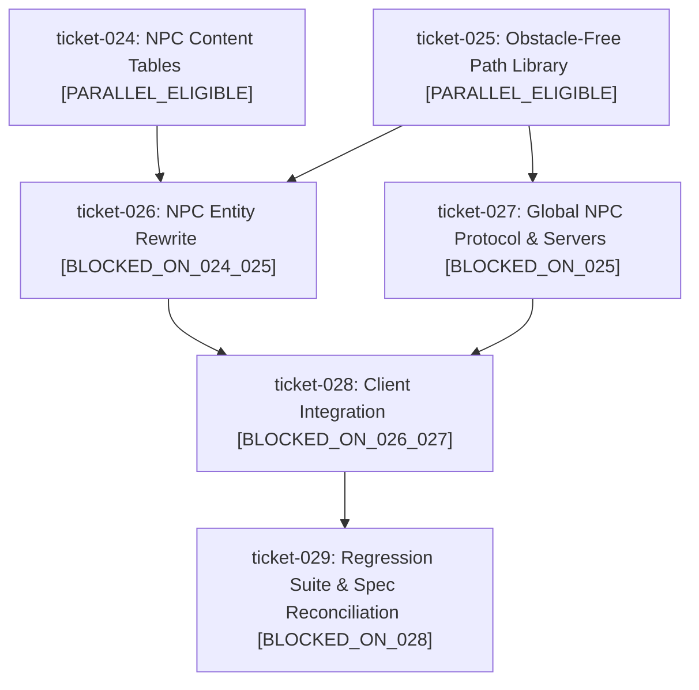

# Milestone Roadmap: Improved NPCs

## 1. Milestone Objective & Scope
Overhaul ambient park NPCs (currently 5 per-client, locally spawned, fast, permanent, and prone to getting stuck on trees/benches/bins):
1. **Obstacle-aware movement** – NPCs follow precomputed paths verified clear of trees, benches and bins.
2. **Global NPCs** – the server is authoritative for spawns/despawns; all clients see the same NPCs. Clients simulate motion deterministically from a shared clock (no per-frame traffic).
3. **Lifecycle** – spawn → walk path → despawn → replacement spawned. Many path variants; only a subset of NPC slots is active at once.
4. **Naming** – "Mary the Walker", "Steve the Jogger". Overhead tag styled distinctly as an NPC (unique colour, italic).
5. **Speed** – NPC speed significantly reduced (walker ~35 px/s, jogger ~80 px/s, down from 85/260).
6. **Speech** – random phrases in the chat bubble: mostly commonplace park/weather/nature remarks, occasionally odd/funny ones (~15%).

**Architecture decisions (agreed):** server-authoritative spawn schedule with deterministic client simulation; precomputed obstacle-free paths (validated by tests) rather than runtime A*. The server relays only `{id, pathId, type, seed, spawnTime}`; clients derive name, appearance, and phrases from `seed` through a shared PRNG (`mulberry32`), so the Python server needs no content tables. A path manifest JSON (`id`, `type`, `lengthPx`) is shared by JS and Python so servers can compute lifetime.

## 2. Ticket Dependency Matrix

| Ticket ID | Title | Thinking Level | Depends On | Concurrency Track | State |
| :--- | :--- | :---: | :--- | :--- | :--- |
| `ticket-024` | NPC Content Tables (names, phrases, appearance, speeds, PRNG) | `LOW` | `[]` | `PARALLEL_ELIGIBLE` | `COMPLETED` |
| `ticket-025` | Obstacle-Free Precomputed NPC Path Library + Manifest | `MEDIUM` | `[]` | `PARALLEL_ELIGIBLE` | `COMPLETED` |
| `ticket-026` | NPC Entity Rewrite: Deterministic Sim, Lifecycle, Tag & Speech | `HIGH` | `["ticket-024", "ticket-025"]` | `PARALLEL_ELIGIBLE` | `IN_PROGRESS` |
| `ticket-027` | Global NPC Protocol & Server Spawners (PartyServer + Python) | `HIGH` | `["ticket-025"]` | `PARALLEL_ELIGIBLE` | `IN_PROGRESS` |
| `ticket-028` | Client Integration: Network NPC Sync & Game Wiring | `MEDIUM` | `["ticket-026", "ticket-027"]` | `BLOCKED_ON_026_027` | `PLANNED` |
| `ticket-029` | NPC Regression Suite & Spec Reconciliation | `MEDIUM` | `["ticket-028"]` | `BLOCKED_ON_028` | `PLANNED` |

## 3. Blast Radius & Scope Collision Matrix

| Ticket ID | Declared File Scope | Overlap Detection & Rationale |
| :--- | :--- | :--- |
| `ticket-024` | `src/entities/npc_content.js` (new), `test/test_npc_content.py` (new) | New files only. Disjoint from all. |
| `ticket-025` | `src/world/npc_paths.js` (new), `src/world/npc_path_manifest.json` (new), `test/test_npc_paths.py` (new). Read-only use of `src/world/field.js`. | New files only. Disjoint from 024, so runs concurrently. |
| `ticket-026` | `src/entities/npc.js`, `test/test_npc_entity.py` (new) | Consumes 024 content API and 025 paths. Sole owner of npc.js. |
| `ticket-027` | `src/net/protocol.js`, `party/server.js`, `server/server.py`, `test/test_npc_server.py` (new) | Disjoint from 026 (no shared files) but needs 025 manifest, so can run concurrently with 026. |
| `ticket-028` | `src/main.js`, `src/net/network.js`, `src/net/ws_network.js` | Needs 026 NPC API and 027 protocol messages. Sole owner of main.js for this roadmap. |
| `ticket-029` | `test/test_npcs.py`, `test/run_tests.py`, `openspec/specs/overview.md` | Final integration; serialized last. |

## 4. Execution DAG Diagram

## 5. Progress & Milestone Completion Criteria
- [x] Ticket-024 completed and merged to `main`.
- [x] Ticket-025 completed and merged to `main`.
- [ ] Ticket-026 completed and merged to `main`.
- [ ] Ticket-027 completed and merged to `main`.
- [ ] Ticket-028 completed and merged to `main`.
- [ ] Ticket-029 completed and merged to `main`.
- [ ] End-to-end tests pass (`python3 test/run_tests.py`).
- [ ] Canonical specifications reconciled in `openspec/specs/`.
