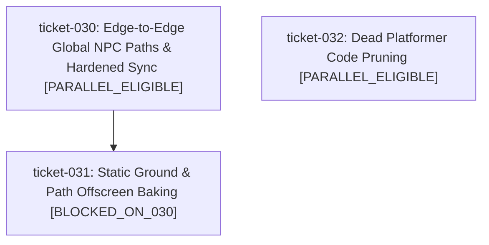

# Milestone Roadmap: Global NPC Polish, Render Optimization & Platformer Pruning

## 1. Milestone Objective & Scope
This roadmap addresses three key initiatives originating from gameplay observations, profiling, and codebase maintenance:
1. **Edge-to-Edge NPC Paths, Realistic Pacing & Authoritative Sync Hardening (`ticket-030`)**:
   - Replace interior looping paths with 10 point-to-point edge-to-edge paths spanning map boundaries.
   - Reduce NPC speeds (walker: 22 px/s, jogger: 48 px/s) and adjust leg animation multipliers.
   - Fix client startup solo-spawn race condition before WebSocket connection.
   - Pre-warm initial server spawns across routes with staggered lifetimes so NPCs don't start simultaneously at distance zero.
   - Add entry fade-in and smooth waypoint turning angles.
2. **Static Ground & Path Offscreen Baking (`ticket-031`)**:
   - Profile/render optimization: bake 3200x2400 static mowing stripes, grass hashes, and gravel paths to an `OffscreenCanvas` on initialization.
   - Blit viewport window using `drawImage` during `renderGround()` to eliminate per-frame Math.sin and Bezier path stroking.
3. **Dead Platformer Code Pruning (`ticket-032`)**:
   - Remove deprecated side-scrolling platformer files (`src/engine/physics.js`, `src/entities/ziggy.js`, `src/entities/collectibles.js`, `src/entities/hazards.js`, `src/level/park_level.js`, and `test/test_physics.py`).
   - Clean tombstone legacy references where safe without breaking regression tests.

---

## 2. Ticket Dependency Matrix

| Ticket ID | Title | Thinking Level | Depends On | Concurrency Track | State |
| :--- | :--- | :---: | :--- | :--- | :--- |
| `ticket-030` | Edge-to-Edge Global NPC Paths, Relaxed Pacing, and Authoritative Sync Hardening | `HIGH` | `[]` | `PARALLEL_ELIGIBLE` | `IN_PROGRESS` |
| `ticket-031` | Static Ground & Path Offscreen Baking (Render Optimization) | `LOW` | `["ticket-030"]` | `BLOCKED_ON_030` | `PLANNING` |
| `ticket-032` | Dead Platformer Code Pruning | `LOW` | `[]` | `PARALLEL_ELIGIBLE` | `COMPLETED` |

---

## 3. Blast Radius & Scope Collision Matrix

| Ticket ID | Declared File Scope | Overlap Detection & Rationale |
| :--- | :--- | :--- |
| `ticket-030` | `src/entities/npc_content.js`, `src/entities/npc.js`, `src/world/npc_paths.js`, `src/world/npc_path_manifest.json`, `party/server.js`, `server/server.py`, `src/main.js`, `src/net/network.js`, `test/test_npc_*.py` | Primary focus on NPC subsystem and client networking. Note: Touches `src/main.js` (NPC startup race condition). |
| `ticket-031` | `src/world/field.js`, `src/main.js` | Touches `src/world/field.js` and `renderGround()` in `src/main.js`. If run concurrently with `ticket-030`, touches different functions in `src/main.js`, but serialized execution or disjoint merge recommended to prevent conflicts. |
| `ticket-032` | `src/engine/physics.js`, `src/entities/ziggy.js`, `src/entities/collectibles.js`, `src/entities/hazards.js`, `src/level/park_level.js`, `test/test_physics.py` | Completely disjoint file set (deleting obsolete files). Completely safe for parallel execution. |

---

## 4. Execution DAG Diagram

> [!NOTE]
> `ticket-030` and `ticket-032` can run immediately in parallel because their file sets are completely disjoint. `ticket-031` is ordered after `ticket-030` because both touch `src/main.js`, eliminating any merge conflict risk.

---

## 5. Progress & Milestone Completion Criteria
- [ ] Ticket-030 completed and merged to `main`.
- [ ] Ticket-031 completed and merged to `main`.
- [x] Ticket-032 completed and merged to `main`.
- [ ] Full automated test suite passes (`python3 test/run_tests.py`).
- [ ] Deployment live on Cloudflare Workers (`https://play.zero-chat.workers.dev`).

