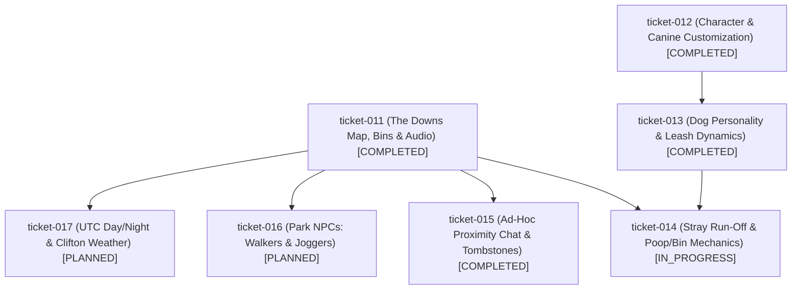

# Milestone Roadmap: The Downs Social Sandbox Expansion

## 1. Milestone Objective & Scope
Transform *Virtual Dog Walker* into **"The Downs"**, inspired by the authentic geography of **Clifton and Durdham Downs** in Bristol, UK. Incorporate enhanced 2D aesthetics, comprehensive human and canine customization, dog personality dynamics and leash physics, canine stray and poop/bin mechanics, ad-hoc proximity group chat with tombstone lifecycles, autonomous park NPCs (walkers and joggers), and real-time UTC day/night sepia twilight with live Clifton Downs weather.

## 2. Ticket Dependency Matrix

| Ticket ID | Title | Thinking Level | Depends On | Concurrency Track | State |
| :--- | :--- | :---: | :--- | :--- | :--- |
| `ticket-011` | The Downs Map Redesign, Bins & Nature Audio | `HIGH` | `[]` | `PARALLEL_ELIGIBLE` | `COMPLETED` |
| `ticket-012` | Character & Canine Customization & 2D Aesthetics | `MEDIUM` | `[]` | `PARALLEL_ELIGIBLE` | `COMPLETED` |
| `ticket-013` | Canine Personality System & Leash Dynamics | `HIGH` | `["ticket-012"]` | `PARALLEL_ELIGIBLE` | `COMPLETED` |
| `ticket-014` | Canine Stray Run-Off & Dog Poop/Bin Mechanics | `MEDIUM` | `["ticket-011", "ticket-013"]` | `PARALLEL_ELIGIBLE` | `IN_PROGRESS` |
| `ticket-015` | Ad-Hoc Proximity Group Chat & Tombstones | `HIGH` | `["ticket-011"]` | `PARALLEL_ELIGIBLE` | `COMPLETED` |
| `ticket-016` | Park NPCs: Autonomous Walkers & Joggers | `MEDIUM` | `["ticket-011"]` | `PARALLEL_ELIGIBLE` | `PLANNED` |
| `ticket-017` | UTC Day/Night Twilight & Clifton Downs Weather | `MEDIUM` | `["ticket-011"]` | `PARALLEL_ELIGIBLE` | `PLANNED` |

## 3. Blast Radius & Scope Collision Matrix

| Ticket ID | Declared File Scope | Overlap Detection & Blast Radius Rationale |
| :--- | :--- | :--- |
| `ticket-011` | `src/world/field.js`, `src/systems/audio.js`, `index.html`, `test/test_downs_map.py` | Expanded world bounds (3200x2400), geography, bins, and nature soundscape. Completed. |
| `ticket-012` | `src/entities/owner.js`, `src/entities/companion_dog.js` (draw), `src/ui/social_hud.js`, `src/style.css` | Avatar rendering and customizer UI. Disjoint from world rendering. |
| `ticket-013` | `src/entities/companion_dog.js` (AI/leash), `src/ui/social_hud.js`, `src/net/protocol.js` | Extends companion dog personality and leash physics. Depends on dog model in 012. |
| `ticket-014` | `src/entities/companion_dog.js`, `src/entities/waste.js`, `src/ui/navigation_arrow.js`, `src/main.js` | Stray run-off and poop pickup. Integrates bins from 011 and obedience from 013. |
| `ticket-015` | `src/ui/proximity_chat.js`, `src/entities/tombstone.js`, `party/server.js`, `src/net/protocol.js` | Spatial chat clusters and tombstones. Isolated social subsystem. |
| `ticket-016` | `src/entities/npc.js`, `src/world/field.js`, `src/main.js` | Ambient pedestrian walkers and joggers along The Downs trails. |
| `ticket-017` | `src/world/environment.js`, `src/systems/weather.js`, `src/world/field.js`, `src/main.js` | Canvas lighting overlay, particle shaders, and live Open-Meteo weather client. |

## 4. Execution DAG Diagram

## 5. Progress & Milestone Completion Criteria
- [x] Ticket-011 completed and merged to `main`.
- [x] Ticket-012 completed and merged to `main`.
- [x] Ticket-013 completed and merged to `main`.
- [ ] Ticket-014 completed and merged to `main`.
- [x] Ticket-015 completed and merged to `main`.
- [ ] Ticket-016 completed and merged to `main`.
- [ ] Ticket-017 completed and merged to `main`.
- [ ] End-to-end integration tests pass across combined deliverables.
- [ ] Canonical specifications reconciled in `openspec/specs/`.
